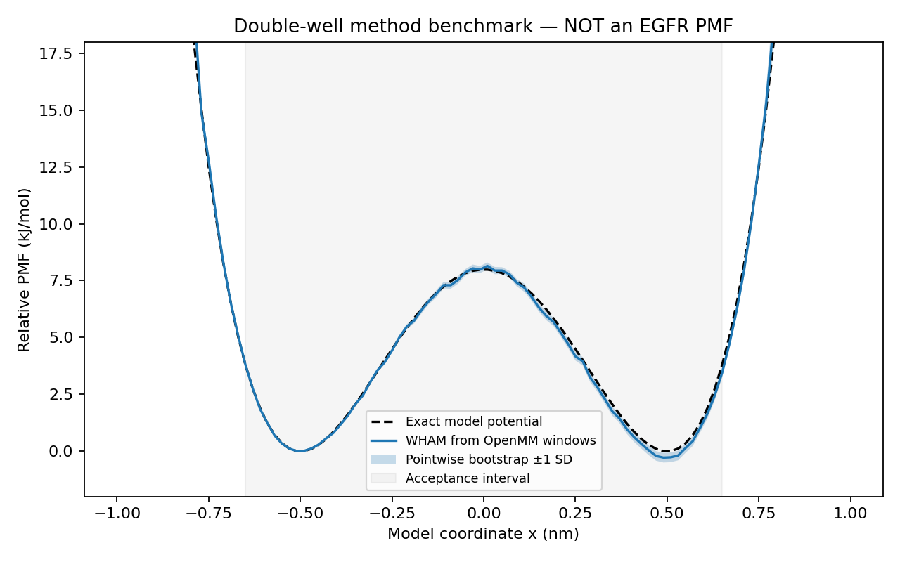
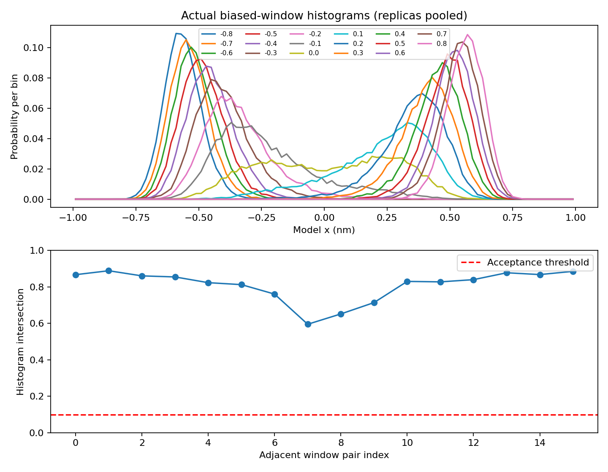
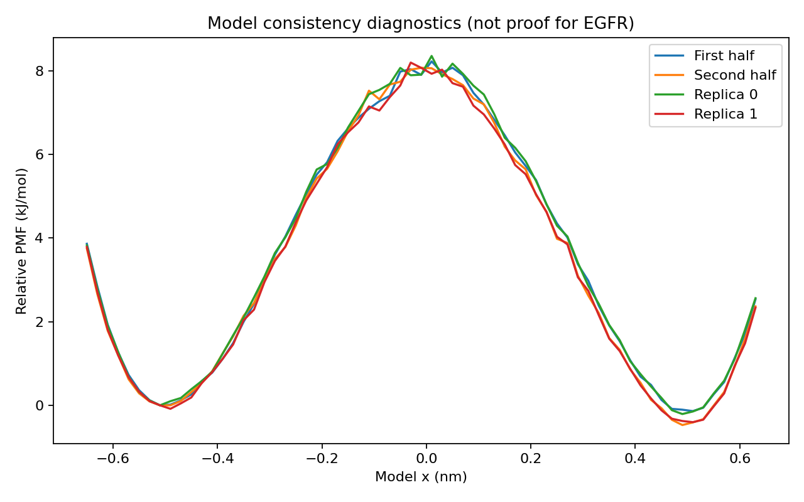

# EGFR ligand unbinding — umbrella sampling

## Question
What does the free-energy profile along an EGFR ligand unbinding path look like?

**The atomistic EGFR profile is not established here.** This executable first
stage validates umbrella sampling and WHAM on a double-well model, then prepares
geometric ligand windows from public [EGFR–erlotinib PDB 1M17](https://www.rcsb.org/structure/1M17).
The PMF below belongs exclusively to the model. No thesis ligand is used.
A bounded explicit-solvent atomistic continuation is recorded separately in
[the protocol](docs/ATOMISTIC_PROTOCOL.md) and `results/atomistic/`; its acceptance
status must not be inferred from the model gates.

## Approach
The [prespecified scope and acceptance gates](docs/SCOPE.md) separate a tractable
method benchmark from the unfinished molecular calculation. OpenMM Reference
(CPU) Langevin dynamics sample a single particle in
`U(x) = 8 * ((x / 0.5)^2 - 1)^2` kJ/mol. Each of the 17 umbrellas
has 2 independently seeded replicas at 300 K,
100 ps discarded burn-in and
1000 ps production per replica/window.

Binned WHAM reconstructs the PMF from actual simulated coordinate histograms.
Autocorrelation-based effective counts, adjacent-window overlap, split-half and
replica comparisons, and circular block bootstrap quantify model accuracy and
consistency. The known potential is used only as a benchmark after reconstruction.
See [methods, assumptions and references](docs/METHODS.md).

## Model results and geometric check
All model numerical gates passed on the recorded run. This does not establish
EGFR convergence or an EGFR free energy.

| Check | Measured result | Acceptance |
| --- | ---: | ---: |
| Complete replica/window series | 34/34 | all complete |
| Finite production samples | 340,000 | 10,000 per series |
| Minimum adjacent histogram overlap | 0.595 | ≥ 0.10 |
| PMF RMSE vs exact model | 0.166 kJ/mol | ≤ 1.0 |
| First/second-half PMF RMSE | 0.198 kJ/mol | ≤ 1.0 |
| Independent-replica PMF RMSE | 0.256 kJ/mol | ≤ 1.0 |
| Minimum estimated effective samples | 140.16 | ≥ 100 |
| Bootstrap reconstructions | 100/100 | ≥ 100 |
| Bootstrap block length | 357 saved samples | ≥ 5 × max inefficiency (71.35) |
| Maximum WHAM offset residual | 9.99990756867e-10 kBT | < 1e-9 |
| Verified EGFR geometric windows | 17/17 | 17 |
| Maximum stored-coordinate projection error | 0.00005659 nm | < 0.0001 |
| Expected/verified output artifacts | 34/34 | all present |

Accuracy and consistency gates apply only to the prespecified assessment
interval; unsupported histogram bins remain NaN. The recorded simulation took
14.739 wall-clock seconds under a sleep/idle inhibitor;
this runtime is for the single-particle benchmark, not a protein simulation.







The public structure supplies 2497 protein atoms and
29 ligand atoms. Translated structures in `results/egfr/` are
geometric starting points only; their direction is not a demonstrated exit path.
The minimum protein–ligand heavy-atom distance across these translations is
0.009750 nm: the straight path contains severe clashes and requires replacement
or physical relaxation before any molecular sampling.

## Atomistic EGFR–erlotinib pilot: PMF yakınsamadı / kanıtlanmadı
The OpenMM run (HIP, AMD RX 9060 XT, 132,590 atoms, explicit TIP3P, ff14SB/GAFF2)
**completed**: 17/17 windows, each 4000 samples = 400 ps production after 20 ps
burn-in (6,432 s wall). All relaxed starts have min protein–ligand heavy distance
0.27–0.39 nm (gate ≥0.15 nm) and the periodic-image margin is 1.80 nm.
Completion is **not** convergence. Re-run `scripts/analyze_atomistic.py` on the
saved series (`results/atomistic/analysis.json`) fails 8 prespecified gates:

| Gate | Required | Observed |
|---|---|---|
| Adjacent histogram overlap | ≥0.10 | min 0.063 (pair 10–11); other 15 pairs 0.139–0.945 |
| Effective samples / window | ≥100 | 2.4–67.5 (every window fails; inefficiency 59–1650 samples) |
| ≥10 bootstrap blocks / window | ≥10 | 0 (block length 8249 > 4000 samples) |
| WHAM solves (full/half/quarter/bootstrap) | residual <1e-9 kBT | full solve converged; the first half-split solve did not (residual 2.2e-5); remaining solves not run |
| Half/quarter agreement, bootstrap | RMSE ≤2 kJ/mol; 100/100 | not evaluable |

Only `results/atomistic/UNACCEPTED_diagnostic.csv` (full-data WHAM) exists; it
is **not** a result and is not plotted as one. No EGFR free energy, barrier or
affinity is claimed. `window_histograms.png` shows biased histograms only.
The stored `analysis.json` that preceded this re-run (made mid-run) was stale.

Method limits: 400 ps per window (sub-ns) is far shorter than ligand/protein
relaxation times (autocorrelation up to ~165 ps in the coordinate alone, hidden
modes slower); a single steered-MD pull supplies all starting states (one exit
route, one trajectory, one seed); all 324 Cα atoms are restrained at
100 kJ/mol/nm²; the 12-residue loop 965–976 is modeled and protonation is
default pH 7.4; one force field (ff14SB/GAFF2/TIP3P, AM1-BCC charges); the
radial coordinate includes radial entropy and no standard-state correction.
Closing the gaps needs much longer windows (the worst window has 2.4 of 100
required effective samples), extra sampling between centers 2.16 and 2.26 nm, and
independent repeat pulls.

## Reproduce
For the original model and geometric preparation workflow, use Linux with conda
and systemd:

```bash
conda env create -f environment.yml
conda activate p23-umbrella
python -m pip install -r requirements-lock.txt
python -m pip install -e . --no-deps
scripts/run_all.sh
```

The runner downloads the public PDB, prepares coordinates, runs production via
`systemd-inhibit --what=sleep:idle`, analyzes results, verifies outputs and runs
pytest. Download provenance is in `results/data_manifest.json`; runtime package
versions are in `results/environment.json`. Seeds/settings are in
`results/model/simulation.json`.

The separate [atomistic protocol](docs/ATOMISTIC_PROTOCOL.md) documents the HIP
workflow, preparation tools, runtime limit and stricter molecular acceptance gates.
`scripts/run_all.sh` runs the original benchmark, not atomistic MD.

To reproduce analysis from the included model coordinate series without MD or network:

```bash
python -m pip install -e '.[test]'
python scripts/analyze_model.py
python scripts/verify_results.py
python -m pytest -q
```

The retained compressed scalar coordinate series is 2,552,101 bytes;
large molecular trajectory formats are ignored. The raw PDB is redownloadable
and ignored. Histograms, bootstrap PMFs, CSV curves, solver diagnostics and output
checksums are included. GitHub Actions runs only offline analysis tests; it
reconstructs the saved PMF from the retained samples and never runs MD.

## Limitations
- The original geometric preparation had no force field or solvent. The atomistic
  continuation now records repair, GAFF2/AM1-BCC parameterization, explicit
  solvent/ions, minimization, equilibration and SMD as separate measured stages.
- EGFR atomistic acceptance is evaluated separately from the model; see
  `results/atomistic/analysis.json`. A PMF is not established unless every
  prespecified atomistic gate passes. Standard-state binding free energy remains
  **not done / not established**.
- Geometric ligand translations can clash with protein atoms. They have no
  force field or solvent and are not production-ready umbrella windows.
- The model has no protein, ligand chemistry, solvent, orientational entropy or
  hidden molecular slow modes. Its PMF cannot answer the EGFR question.
- Bootstrap bands are pointwise one-standard-deviation estimates, conditional
  on sampled trajectories and estimated correlation lengths; they omit model
  error, unsampled modes and binning bias. Split-half agreement is a diagnostic,
  not proof of convergence for any molecular system.
- Standard-state binding free energy and multiple molecular exit pathways:
  **not done**.
